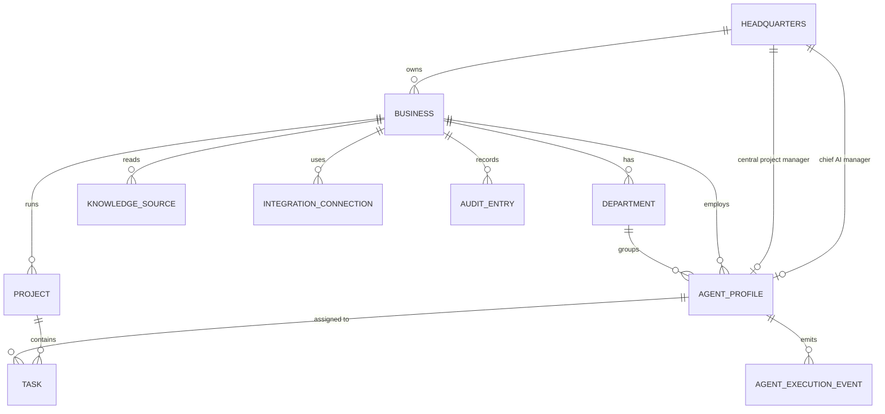

# Multi-Business Data Model

TypeScript definitions live in `src/domain/`. No database exists yet; these
types are the contract persistence will implement.

## Entity overview

## Entities

| Entity | File | Scope | Key fields |
| --- | --- | --- | --- |
| `Headquarters` | `business.ts` | top-level tenant | `chiefAiManagerAgentId`, `centralProjectManagerAgentId` |
| `Business` | `business.ts` | sector | `slug`, `sector`, `status`, `leadAgentId`, `officeLayout` |
| `Department` | `business.ts` | business | `businessId`, `function` |
| `AgentProfile` | `agent.ts` | HQ or business | `role`, `lifecycle`, `model`, `allowedTools`, `reportsTo`, `avatar` |
| `Project` | `work.ts` | HQ or business | `status`, `ownerAgentId` |
| `Task` | `work.ts` | HQ or business | `status`, `assigneeAgentId`, `requiresHumanApproval` |
| `KnowledgeSource` | `knowledge.ts` | HQ or business | `kind: "obsidian-vault"`, `locationRef`, `access: "read-only"` |
| `KnowledgeNote` | `knowledge.ts` | HQ or business | Markdown note + frontmatter (`kind`, `project`, `agent`, `tasks`, `confidentiality`, `origin`); see [KNOWLEDGE.md](KNOWLEDGE.md) |
| `IntegrationConnection` | `integration.ts` | HQ or business | `kind`, `status`, `secretRef`, `scopes` |
| `AuditEntry` | `audit.ts` | HQ or business | `actor`, `action`, `target` - append-only |
| `AgentExecutionEvent` | `agents/events/types.ts` | HQ or business | see [AGENT_EVENTS.md](AGENT_EVENTS.md) |

## Design decisions

- **Branded IDs** (`BusinessId`, `AgentId`, ...) prevent mixing IDs at compile
  time.
- **`businessId: null` means HQ-level.** HQ-level agents (Chief AI Manager,
  Central Project Manager) and cross-business projects use `null`.
- **Isolation by `businessId`.** Every business-owned row carries it (Tasks
  denormalize it from their Project for cheap scoped queries).
- **Activity is not stored on agents.** `AgentProfile.lifecycle` is the
  admin state (draft/enabled/disabled/retired). Live activity is derived from
  the event stream, so it cannot drift from reality or be faked.
- **No secrets in records.** `IntegrationConnection.secretRef` references a
  server-side secret store entry.
- **Default-deny lists.** `allowedTools` and `scopes` empty = nothing allowed.
- **Office layout is data.** `Business.officeLayout` and
  `AgentProfile.avatar` give the renderer positions without hard-coding.
- **Model binding is config.** `{ provider, model }` lets each agent use Claude,
  OpenAI, or Grok without code changes.

## Future persistence notes

- Suggested tables mirror the entities 1:1; composite indexes on
  `(business_id, ...)` for every business-owned table.
- `agent_execution_events` is append-only, indexed by `(run_id, sequence)` and
  `(business_id, occurred_at)`.
- Consider row-level security (e.g. Postgres RLS) keyed on `business_id` when a
  multi-user mode is added.
